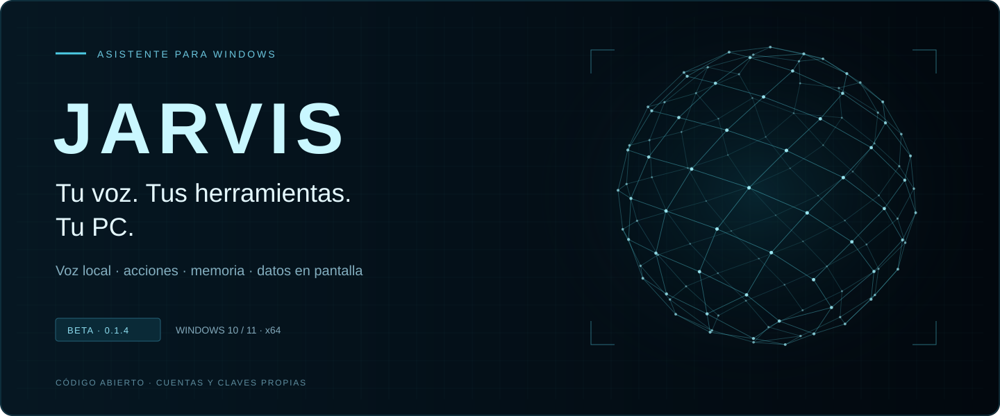
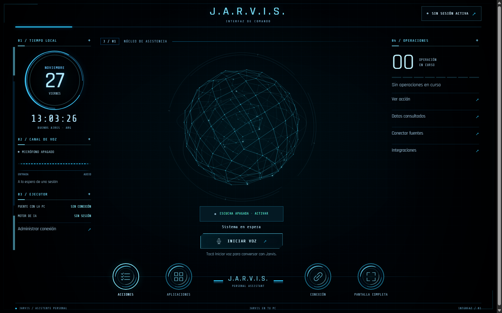
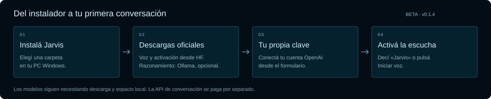
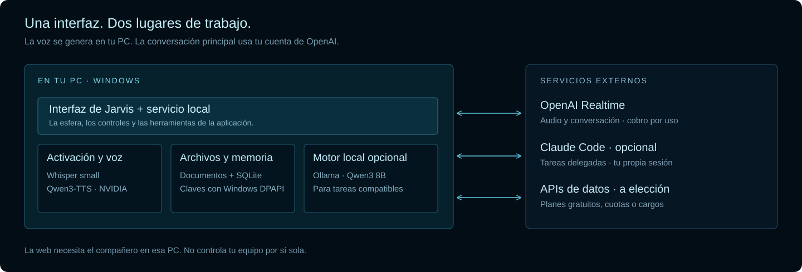

  

  <strong>Un asistente de escritorio para conversar, crear archivos y consultar información.</strong> 
  Voz generada en tu PC, memoria local y herramientas conectadas a tus propias cuentas.

  <a href="https://github.com/guzadev/jarvis/releases/download/v0.1.4/Jarvis-Windows.exe"><strong>↓ Descargar para Windows</strong></a> ·
  <a href="docs/INSTALACION-WINDOWS.md">Guía de instalación</a> ·
  <a href="docs/DESARROLLO.md">Explorar el código</a> ·
  <a href="https://github.com/guzadev/jarvis/releases/tag/v0.1.4">Release v0.1.4</a>

> **Beta 0.1.4 · Windows x64 · GPU NVIDIA requerida para la voz incluida.**
> La conversación principal usa OpenAI y genera cargos de API. Cada persona utiliza sus propias claves y cuentas.

## Así se ve

Vista de la interfaz del repositorio, renderizada sin sesión, micrófono ni servicios activos. No es una demostración de respuesta o rendimiento. La portada y el diagrama son ilustraciones propias.

## De la voz a la acción

| Conversá | Creá | Consultá |
| :--- | :--- | :--- |
| Decí «Jarvis» y hacé tu pedido, o usá **Iniciar voz**. | Generá archivos y delegá tareas a un motor configurado. | Recibí datos, imágenes y tablas dentro de la interfaz. |
| La activación y la síntesis de voz son locales. | Los resultados quedan en tus carpetas de trabajo. | Cada fuente conserva sus requisitos y sus cuotas. |

Algunos pedidos para empezar:

- **«¿A cuánto está Bitcoin en dólares? Mostralo en pantalla».**
- **«Mostrame la publicación astronómica del día de la NASA».** Puede ser una imagen o un video.
- **«¿Cómo va a estar el clima mañana en Rosario?».**
- **«¿Cómo está el tránsito cerca del Obelisco de Buenos Aires?».** Muestra flujo e incidentes; no calcula una ruta ni hora de llegada.
- **«Creá una calculadora web sencilla y abrila en Chrome».** Requiere Claude Code configurado para delegar la creación y abrir el HTML del proyecto.
- **«Creá un Excel con estos datos…».** Los trabajos se guardan en `Documentos/Jarvis/General`.

Crear una app es una tarea en segundo plano. Se considera iniciada cuando el motor devuelve una misión; la conversación puede seguir disponible mientras trabaja.

## Instalalo en tu PC

| Antes de descargar | Requisito |
| :--- | :--- |
| **Sistema** | Windows 10/11 de 64 bits. Validado en Windows 11. |
| **Voz local** | GPU NVIDIA compatible con CUDA y controlador instalado. Probado en RTX 3060. |
| **Espacio** | Reservá **25 GB libres para la base** y, como orientación, **15 GB adicionales** si elegís modelos de razonamiento. Depende del modelo y del equipo. |
| **Tamaño del instalador** | Consultá los archivos de la [Release v0.1.4](https://github.com/guzadev/jarvis/releases/tag/v0.1.4). Los pesos de los modelos se descargan por separado. |
| **Conversación** | Internet y cuenta OpenAI con saldo de API. |
| **Tareas con Claude** | Acceso propio a Claude Code; es opcional. |

1. **Descargá [Jarvis-Windows.exe](https://github.com/guzadev/jarvis/releases/download/v0.1.4/Jarvis-Windows.exe).** Es el asistente de descarga, no el código fuente.
2. **Abrilo y elegí una carpeta con espacio.** Pulsá **Descargar e instalar**: descarga las partes, verifica sus SHA-256 y abre el instalador completo.
3. **Instalá y abrí Jarvis** desde el escritorio o el menú Inicio. No necesitás instalar Python ni Node. En el primer inicio descarga automáticamente los pesos de voz y activación desde Hugging Face, con progreso, reanudación y cancelación.
4. **Pegá tu propia clave de OpenAI** en el formulario. Seguí la [guía de clave y facturación](docs/CLAVE-OPENAI.md).
5. **Activá la escucha cuando quieras usarla.** Pulsá **ESCUCHA APAGADA · ACTIVAR**, decí «Jarvis» y hacé tu pedido. También podés pulsar **Iniciar voz**.

El instalador incluye los **runtimes, Python, las dependencias preparadas y el perfil de voz**. **No incluye los pesos de Qwen, Whisper ni modelos de razonamiento; no se alojan en las Releases de GitHub.**

En el primer inicio se descargan **Qwen3-TTS 1.7B Base (4,544 GB)** y **Whisper small (0,486 GB)**: **5,03 GB de pesos desde Hugging Face**, además de la descarga del instalador. Las versiones están fijadas y los archivos se verifican con SHA-256. El perfil de voz elegido se conserva. Estas descargas siguen ocupando espacio local.

**El razonamiento local es opcional.** El instalador permite elegir entre modelos Qwen3 de **1.7B, 4B, 8B y 14B**. Después podés ver los instalados, descargar otro, cambiar o eliminar uno desde **Acciones → Motor, voz y carpeta → Modelos locales**. El runtime de Ollama se obtiene de sus Releases oficiales y los modelos, del registro de Ollama. El motor anterior se conserva hasta que el nuevo esté preparado; el que está en uso queda protegido contra el borrado.

La configuración inicial conserva OpenAI para conversar. Descargar modelos locales no hace gratuita la API. No se incluyen cuentas, claves, memoria ni proyectos del desarrollador.

Esta edición no ofrece una voz CPU equivalente ni cambia automáticamente la voz si falta NVIDIA. La velocidad depende del hardware; la primera frase puede tardar mientras se prepara el modelo.

<strong>Descarga manual, verificación y ejecutable sin firma</strong>

Desde la [misma versión de Releases](https://github.com/guzadev/jarvis/releases/tag/v0.1.4), descargá `Jarvis-Windows-Instalador.exe` y **todas** las partes `Jarvis-Windows-Instalador-*.bin`. Dejalas juntas en una carpeta y ejecutá ese EXE.

`Source code.zip` contiene código; no es el instalador. El descargador requiere Internet y conserva los archivos en la carpeta elegida.

El ejecutable no tiene firma de editor comercial. `SHA256SUMS.txt` permite comprobar que los archivos coinciden con la versión publicada. Consultá la [guía de instalación](docs/INSTALACION-WINDOWS.md) para verificar las huellas y resolver problemas.

## Configuralo a tu manera

| Quiero… | Guía |
| :--- | :--- |
| **Conversar con OpenAI** | [Crear y cargar mi clave](docs/CLAVE-OPENAI.md) |
| **Delegar tareas a Claude Code** | [Conectar mi cuenta de Claude](docs/CONECTAR-CLAUDE.md) |
| **Conectar fuentes y otras APIs** | [Agregar APIs gratis o pagas](docs/AGREGAR-APIS.md) |
| **Resolver un problema de instalación** | [Instalación, controles y problemas frecuentes](docs/INSTALACION-WINDOWS.md) |
| **Trabajar con el código** | [Arquitectura y desarrollo](docs/DESARROLLO.md) |

Incluye herramientas para clima, tránsito, dólar, divisas, acciones, criptomonedas, noticias y NASA. Conectá las claves necesarias en **Integraciones → Fuentes de datos de Jarvis**.

También admite importar **OpenAPI 3.0/3.1 en JSON** o definir operaciones **REST** manualmente. Jarvis necesita la URL y las funciones de cada servicio; el nombre de una app y una clave no siempre alcanzan. OAuth, cargas de archivos y protocolos especiales no son conectores universales automáticos.

## Qué corre en cada lugar

La conversación y las tareas tienen selecciones independientes: podés usar **OpenAI para conversar y Claude para las tareas**, conservando la voz local. **Electron** presenta la interfaz; el **servicio Python** conecta las herramientas; **OpenJarvis** orquesta el motor de tareas. La memoria usa **SQLite** y las credenciales locales se protegen con **Windows DPAPI**. La síntesis local no llama a Fish Audio. No entrenamos un modelo desde cero.

La [interfaz online](https://jarvis-aurelio.vercel.app/) requiere el compañero instalado **en la PC que querés utilizar**. Vercel no ejecuta los modelos de voz ni controla por sí solo tu computadora.

## Micrófono, privacidad y costos

- **Vos activás la escucha.** Empieza apagada. **Apagar** corta el micrófono y la conversación.
- **Cerrar con la X sale de la app.** No la oculta en la bandeja. Minimizar, ocultar o cambiar de ventana también suspende la escucha; volvé a activarla para continuar.
- **El inicio con Windows es opcional.** No se habilita solo ni activa por sí mismo el micrófono.
- **Activación y síntesis locales; conversación externa.** Durante la conversación activa, el audio se envía a OpenAI.
- **OpenAI cobra por uso.** ChatGPT Plus/Pro y el saldo de API se administran por separado. Claude Code usa el acceso y los límites de tu propia cuenta.
- **Las otras APIs tienen sus propias condiciones.** Pueden ofrecer planes gratuitos, cuotas o cargos. Un límite de solicitudes de Jarvis no es un límite monetario del proveedor.

La memoria es local y no se sincroniza automáticamente entre PCs. No publiques `.env`, claves, tokens, perfiles personales, bases de datos, grabaciones ni archivos de tus proyectos en issues o pull requests. Leé la [política de seguridad](SECURITY.md) antes de reportar información sensible.

## Una beta, con límites concretos

La voz puede variar de timbre en algunas frases. Correo, calendario y redes necesitan sus conectores. Las tareas usan las herramientas habilitadas: no hay control ilimitado de cualquier programa. El instalador incluye los componentes, pero no se probó en todos los equipos ni sustituye los controladores NVIDIA.

## Código y créditos

El código está en este repositorio y los instaladores se distribuyen en **[Releases](https://github.com/guzadev/jarvis/releases)**. Los pesos se descargan desde sus proveedores oficiales; no se alojan en GitHub. Para compilar, verificar paquetes o contribuir, empezá por [Desarrollo](docs/DESARROLLO.md).

Basado en el template de **Thomas Berton** y ampliado con [OpenJarvis](https://github.com/open-jarvis/OpenJarvis), [Qwen3-TTS](https://github.com/QwenLM/Qwen3-TTS) y [faster-qwen3-tts](https://github.com/andimarafioti/faster-qwen3-tts). Se conserva la [licencia del código base](LICENSE); cada componente conserva sus avisos de terceros. La inspiración visual no implica afiliación: **no es un producto oficial de Marvel**.
